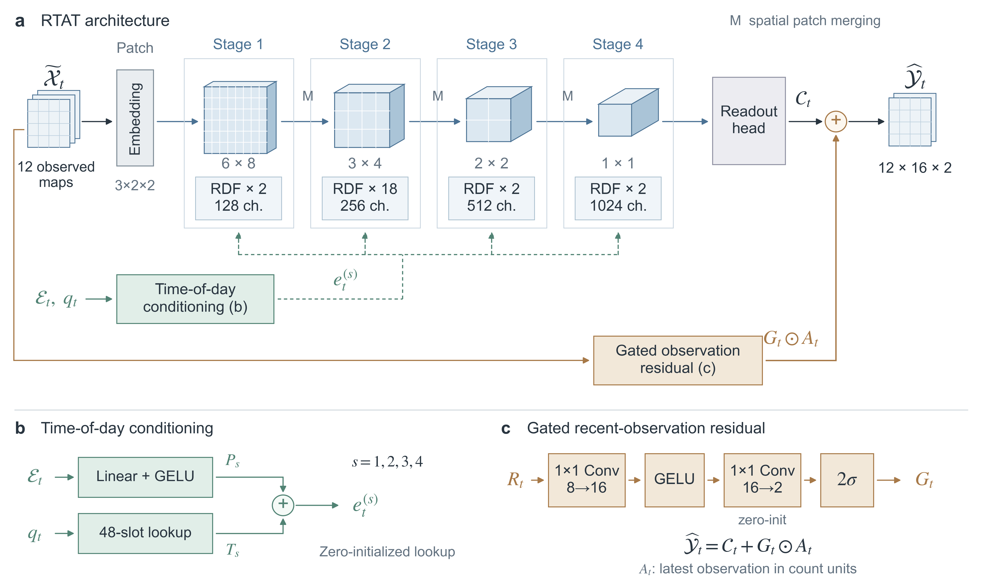

# RTAT

**RTAT with Gated Recent-Observation Residuals and Time-of-Day Conditioning for Grid-Based Urban Flow Forecasting**

RTAT predicts two-channel urban flow maps on a 12 × 16 grid. The implementation combines a hierarchical regional-attention backbone, stage-wise time-of-day conditioning, and a gated residual from recent observations.



This repository provides model code, training, explicit weight-only fine-tuning, path/component ablation interfaces, prediction, spatial evaluation and multi-seed aggregation. Six NYCTaxi/NYCBike profiles cover 30-, 60- and 90-minute intervals. The matching reconstructed calendar files and 38-column external-feature arrays are included in [`external_data/`](external_data/README.md).

**Release scope:** trained weights, historical prediction files, original training logs and private run records are not distributed. Flow benchmark arrays are obtained from the original provider. The repository supports running new RTAT experiments; exact equality with every historical manuscript result across software/hardware environments is not certified. See [validation scope](docs/VERIFICATION.md).

## Install and check

Use Python 3.10. Create a separate environment and install a PyTorch build suitable for your hardware. Reference dependencies are pinned below; analysis dependencies additionally install Matplotlib.

```bash
python -m pip install -r requirements.txt
python -m unittest discover -s tests -v
python examples/forward.py
```

Reference checks use PyTorch 2.6.0 and NumPy 2.2.6. CPU checks require no CUDA device. Full training is intended for a CUDA GPU; the default batch size is 128. `--workers 0` works on Windows and Linux. The forward example uses random weights and synthetic inputs; it is not a paper accuracy result.

## Prepare data

1. Obtain the processed flow benchmark from [ProSTformer](https://github.com/yanxiao1930/ProSTformer_code). Its README provides the NYCTaxi and NYCBike download links. Keep the original `data_x_30/60/90.npy` and `data_y_30/60/90.npy` files under `benchmark/data_nyctaxi/` and `benchmark/data_nycbike/`.
2. Use the exact calendar/external arrays shipped here. The following command checks expected SHA256 hashes and creates a new portable data directory:

```bash
python prepare_data.py --flow-root benchmark --external-root external_data --output-root data
python train.py --data-root data --dataset nyctaxi --minutes 30 --validate-only
```

For one profile, add `--dataset nyctaxi --minutes 30` to `prepare_data.py`. Choose a new output directory; existing directories are refused. Quote paths containing spaces.

Expected prepared layout:

```text
data/
  flow/data_nyctaxi/data_x_30.npy
  flow/data_nyctaxi/data_y_30.npy
  external/data_nyctaxi/external_30.npy
  external/data_nyctaxi/external_30.json
  external/data_nyctaxi/timestamps_30.csv
  ... remaining dataset/interval profiles
```

Flow inputs are `[N,12,2,12,16]`; targets are `[N,2,12,16]`. Channel 0 is outflow and channel 1 is inflow. The 12 selected maps comprise four weekly, four daily and four recent observations in chronological order. They are not 12 consecutive time steps. See [data protocol](docs/DATA_PROTOCOL.md) and [data access](docs/DATA_ACCESS.md).

## Train

```bash
python train.py --data-root data --dataset nyctaxi --minutes 30 --variant full --seed 0 --output runs/taxi30_full_seed0
```

Use seeds 0, 1 and 2 in separate directories. Dataset options are `nyctaxi` and `nycbike`; interval options are `30`, `60`, and `90`. Runs without `--init-from` start from scratch.

For a three-seed suite, the runner below prints commands first. Remove `--dry-run` to run them sequentially on one device:

```bash
python run_suite.py --data-root data --output-root runs/full_taxi30 --dataset nyctaxi --minutes 30 --variants full --seeds 0 1 2 --dry-run
```

To fine-tune, first train a 30-minute source checkpoint from the same dataset. Then explicitly supply it:

```bash
python train.py --data-root data --dataset nyctaxi --minutes 60 --variant full --seed 0 --init-from runs/taxi30_full_seed0/best_checkpoint.pt --output runs/taxi60_full_finetune_seed0
```

This transfers learned weights while retaining target-interval scaling and anchor buffers and creating a new optimizer. Source seed/hash and target configuration are recorded. Direct training and fine-tuning are distinct protocols; this interface does not infer historical source-checkpoint choices. Checkpoints saved by this code contain model weights and metadata, not optimizer state for exact interrupted-run resumption.

## Ablations and summaries

Five path variants are available: `backbone`, `tod`, `fixed_residual`, `gated_residual`, and `full`. A complete paired path experiment uses all five variants and seeds 0, 1 and 2:

```bash
python run_suite.py --data-root data --output-root runs/path_taxi30 --dataset nyctaxi --minutes 30 --variants backbone tod fixed_residual gated_residual full --seeds 0 1 2 --dry-run
python summarize.py --runs-root runs/path_taxi30 --output results/path_taxi30_summary.json
```

Remove `--dry-run` to train. `run_suite.py` stops on the first failed command and refuses pre-existing run directories; it never silently mixes new and archived runs. The summary command runs after training has completed. Means and sample standard deviations (`ddof=1`) are computed from completed runs, with explicit missing-seed and duplicate-seed checks and paired variant-minus-full differences.

For component-removal experiments, use `train.py --disable-component lag_bias`, `temporal_mask`, `shifted_windows` or `external` with the other required arguments. Each launches a fresh experiment. Removing the external branch is incompatible with ToD: select `backbone` or `gated_residual`. These options do not promise to recreate arbitrary historical single-run ablation scores.

## Predict and evaluate

After training, the local run directory supplies the checkpoint and fitted scalers:

```bash
python predict.py --checkpoint runs/taxi30_full_seed0/best_checkpoint.pt --input-scaler runs/taxi30_full_seed0/input_scaler.npz --external-scaler runs/taxi30_full_seed0/external_scaler.json --flow input_history.npy --external input_external.npy --slots input_slots.npy --output predictions.npy --device cpu
python -m pip install -r requirements-analysis.txt
python src/evaluation_metrics.py runs/taxi30_full_seed0/test_predictions.npz --train-target data/flow/data_nyctaxi/data_y_30.npy --train-stop 48528 --output-dir results/taxi30_spatial
```

`input_history.npy` contains raw-count observations; `input_external.npy` contains the 38 unstandardized external columns; `input_slots.npy` contains integer reconstructed half-hour IDs 0–47. Predictions are raw counts, without clipping. Use the matching training stop from `configs/` for each dataset and interval. Pretrained weights are not needed to start new training; inference requires weights trained by the user or separately obtained.

## Layout and scope

- `src/`: backbone, conditioning/residual paths, scaling, data access and evaluation.
- `configs/`: six fixed benchmark profiles.
- `external_data/`: matched external arrays, reconstructed calendar CSVs, portable metadata and attribution.
- `data_metadata/`: expected hashes and feature schemas.
- `tests/`, `examples/`: CPU protocol checks and a synthetic forward example.
- `docs/`: data protocol, acquisition instructions and validation scope.

Independent third-party baseline implementations and raw-trip-to-grid construction are outside this repository. Full RTAT has 64,812,306 trainable parameters. Input scaling uses training observations only; the final four weeks form the test set and the preceding four weeks form validation. Calendar labels are reconstructed and weather covariates use lagged retrospective ERA5 rather than operational forecasts. Array indices alone do not establish geographic coordinates.

[中文说明](README_zh.md) · [Data attribution](external_data/ATTRIBUTION.md) · [Third-party notices](THIRD_PARTY_NOTICES.md)

No project-wide open-source license has been selected by the rights holders. Public visibility alone does not supply a software reuse license; upstream data terms remain applicable.
